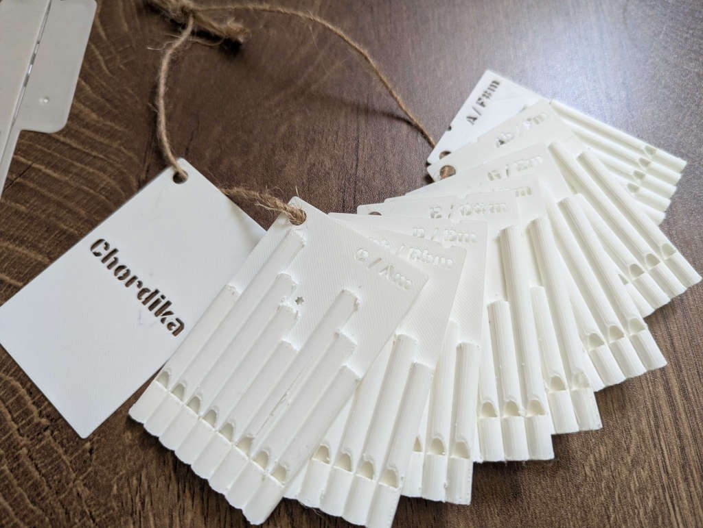

# Chordika &amp; Recorika

**Card-sized 3D-printed whistles. Swap a card, change the key.**

日本語版は [README.ja.md](README.ja.md) をご覧ください。

Eight fipple pipes are 3D-printed into a credit-card-sized plate (85.6 × 54 × 4 mm).

- **Chordika** — blow any three adjacent pipes in one breath and a tuned triad sounds.
  Twelve cards cover every key, and the position-to-chord mapping is *identical* on all of
  them, so the same hand motion transposes when you swap the card.
- **Recorika** — the scale counterpart: one octave of a major scale, lowest pipe on the
  left, highest on the right. Available in G, A♭ and A.
- **Recorika Chromatic** and **Recorika Chromatic Square** — twelve pipes one semitone
  apart (G#6 to G7). Slide the card sideways across your lips for a chromatic run, wiggle it for a trill.
  The Square packs the pipes closer into a square; pitch and tone are steadier on the
  standard model. (Added in October 2026.)
- **Recorika Chromatic Tiny** — the smallest Recorika Chromatic (66.0 × 53.8 × 4 mm). (Added in November 2026.) Its lowest note (G#6) does not sound reliably, so if you want to play properly, use Recorika Chromatic Square or the standard Recorika Chromatic.

The data is published, so anyone with a 3D printer can make the same thing. Each Chordika and Recorika card is exactly credit-card sized, so it travels in a wallet or a card case. Recorika Chromatic and Recorika Chromatic Square are larger — the shorter side is 64.5 mm — and will not fit in a wallet's card slot. The outline of Recorika Chromatic Tiny fits inside a credit card's.



**Project site: https://unryu.org/chordika/**

## The layout

On every Chordika card, the same pipes give the same chord function:

| Pipes | 1·2·3 | 2·3·4 | **3·4·5** | 4·5·6 | 5·6·7 | 6·7·8 |
|---|---|---|---|---|---|---|
| Chord | V | iii | **I** | vi | IV | ii |
| on C / Am | G | Em | **C** | Am | F | Dm |
| on G / Em | D | Bm | **G** | Em | C | Am |

Positions are counted from the left, with the windows facing up and the mouthpiece edge
towards you. The tonic pipe is marked with a ＊ on the card.

Each card therefore carries a major key *and* its relative minor. Only vii° (the
diminished triad) is missing.

This works because the notes follow the **degree chain 2·4·6·1·3·5·7·2** rather than pitch
order, which makes every three adjacent pipes a diatonic triad. On the card that chain runs
from the right-hand end towards the left.

## What's in this repository

```
index.html          project site (Japanese / English)
stl/                print data — 12 Chordika cards, 3 Recorika cards, 3 Recorika Chromatic models, 1 cover, 2 box parts
stl/inverted/       bonus: the 12 Chordika cards with the pipe order mirrored
3mf/                pre-sliced files
                    *_a1mini_pla_2026-11: recommended — Bambu Lab A1 mini, PLA Basic, the November 2026
                      settings that played (12 Chordika keys, Recorika A♭, Recorika Chromatic)
                    *_a1mini_pla: the older August 2026 A1 mini settings (Chordika, Recorika G/A♭/A, cover, box)
                    recorika_chromatic_*_h2d_petg: 4 files for the Bambu Lab H2D in white PETG
3mf/inverted/       the same 12 inverted cards, pre-sliced
video/              short clips of the cards being played
assets/             cheat sheets (JA/EN), chord maps for all 12 keys, photos and figures
```

**Hear them:** start with the [demo video on YouTube](https://www.youtube.com/watch?v=5BZod5VixxM).
The [project site](https://unryu.org/chordika/) also has short clips — chords on
Chordika, the scale on Recorika, and a tune played on it.

If you own a **Bambu Lab A1 mini**, start with the files ending in `_a1mini_pla_2026-11`
in `3mf/`. In November 2026, Chordika (A♭ / Fm), Recorika (A♭) and Recorika Chromatic were
printed on an A1 mini in white PLA (Bambu PLA Basic) and every pipe sounded; these files are
sliced with exactly those settings and can be sent straight to the printer. A Chordika or
Recorika card is about 8 g and 2 h 20 min; Recorika Chromatic is about 12 g and 3 h 10 min.
The other eleven Chordika keys use the same settings but have not yet been printed with them.
Recorika in G and A has not been printed with them either, so only the STL and the older
August 2026 3mf (`_a1mini_pla`) are provided for those two.

The older `_a1mini_pla` files (August 2026) are kept as they were: 0.2 mm first layer,
30 mm/s outer walls and a 5 mm brim with gap 0, about 1 h 25 min per card.
For any other printer or filament, slice the STL yourself using the settings below.

## Printing

These are the settings with which the cards played on an A1 mini in white PLA (November 2026).
They start from the Bambu Studio system preset `0.12mm Fine @BBL A1M`.

- **0.08 mm layers (0.12 mm first layer), 0.5 mm outer wall.** The pipe walls are thin; do not print coarse.
- **Slow walls:** 15 mm/s outer, 25 mm/s inner.
- **Nozzle 220 °C, bed 65 °C (Textured PEI Plate), part-cooling fan at most 80%.**
- **No supports.** Print flat, as-is.
- **One card per plate.** Two cards on one plate double the time per layer, the edges cool
  and shrink, and the card warps. A brim alone will not stop it.
- **Brim 8 mm, brim-to-object gap 0.1 mm.**
- Recorika Chromatic Square printed on an A1 mini in white PLA had a weak second-lowest note;
  for the Square, the H2D files in white PETG are recommended (slow the internal solid infill
  to about 70 mm/s).
- White PLA works well. Translucent PETG is beautiful — the bores show through the plate.

**Remove any sharp spots before you blow into it.** A fresh print leaves fine burrs and
sharp corners, and this is an instrument you put to your lips — as printed it is not safe.
I have come close to cutting my mouth on one more than once. Run a finger along the card's
edges and around the mouthpieces, and smooth anything that catches with a file or the back
of a knife.

All eight mouthpieces sit in a straight line along one edge of the card: keep your lips on
that edge and slide the card sideways across them. Blow with about as much breath as a recorder — too hard and
the pipe jumps an octave.

## Cover card and box

The **cover** (`chordika_cover.stl`) is a 0.5 mm plate with no pipes and "Chordika" cut
through it. It shares the cards' outline and strap-hole position, so it stacks on top of
the twelve and threads onto the same cord.

The **box** is two parts: an open tray (`chordika_box_base.stl`) and a lid that slips over
its outside (`chordika_box_lid.stl`). All thirteen cards lie flat inside, and the lid
carries the same cut-through lettering as the cover. A scallop on each long side lets you
pinch a card out. Closed, it is about 94 × 62 × 57 mm.

The box holds no pipes, so it prints at **ordinary 0.2 mm layers with no supports** — no
need for the fine settings the cards require.

## How it was designed

Pipe length and pitch were fitted from real printed-and-blown pipes as `f = A/(L+e)`.
Solving it backwards turns a wanted note into a length, so a generator written in Python
(trimesh + manifold3d) emits the whole card from a key name. The plate thickness is fixed
at 0.5 mm — exactly the floor thickness of the pipes; any thicker and it eats into the
bore and the card goes silent.

## Licence

[CC BY-NC-ND 4.0](https://creativecommons.org/licenses/by-nc-nd/4.0/) — see [LICENSE](LICENSE).

**You may** print these for your own use, play them, and share them unchanged with credit,
including non-commercially in classes and workshops.
**You may not** use them commercially (selling prints, paid services) or distribute
modified data. If you want different terms, please get in touch.

---

From the "AI whistle-making" project by Kazutaka Kurihara (Tsuda University).
